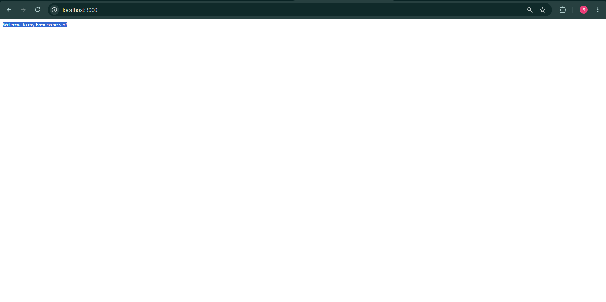
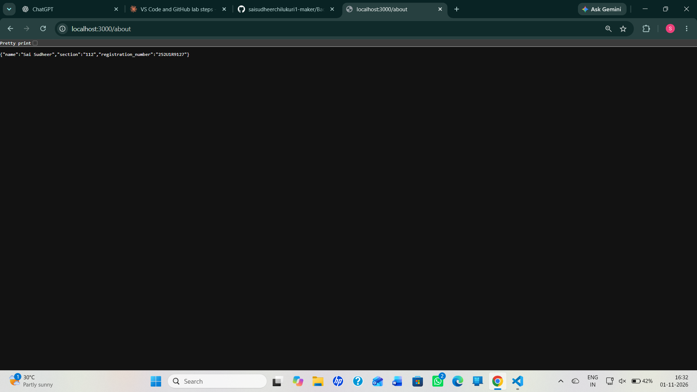
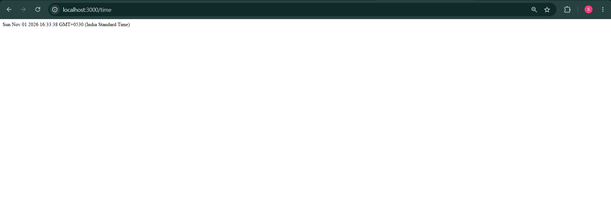
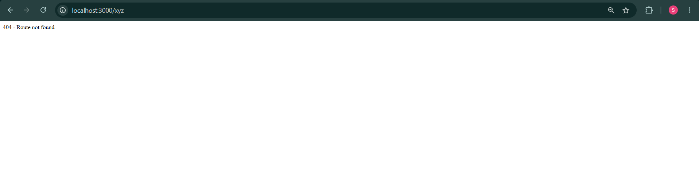

# Lab 1: Node.js and Express server

Sai Sudheer · 252U1R9127 . 112

**Live link:** Not deployed (see Notes). Postman/browser screenshots are below.

## How to run
```bash
cd lab-01
npm install
npm start
```
No environment variables are required. The server runs on http://localhost:3000.

## Endpoints
| Method | Path | Description |
|--------|--------|-------------|
| GET | / | Welcome text (200) |
| GET | /about | JSON with name and section (200) |
| GET | /time | Current date and time (200) |
| GET | any other path | 404 message (404) |

## Screenshots





## Notes
 I first ran npm init in the wrong folder, deleted the files and re-ran it inside lab-01, and added .gitignore so node_modules was not committed.