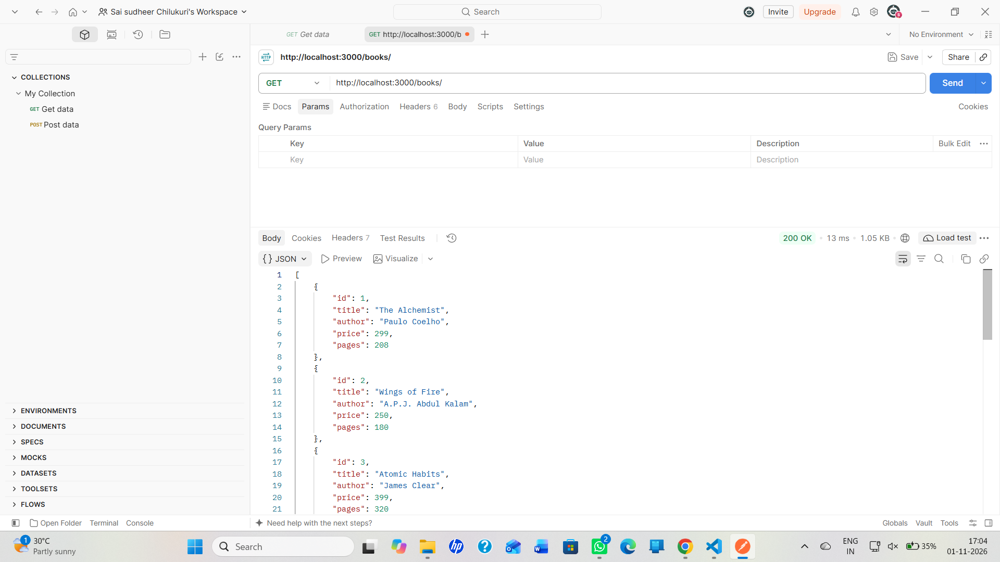
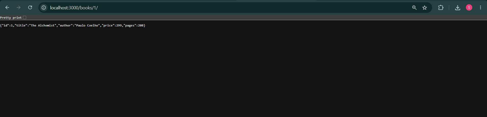
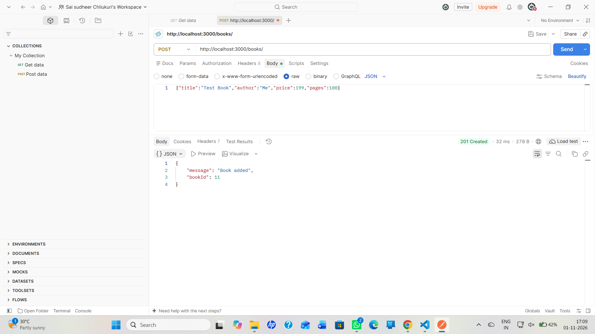
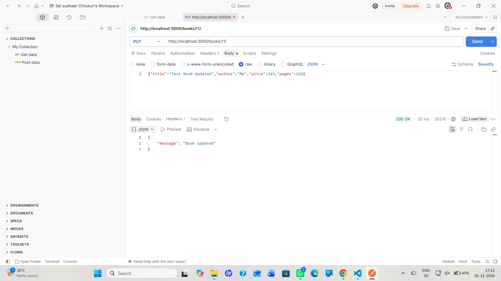
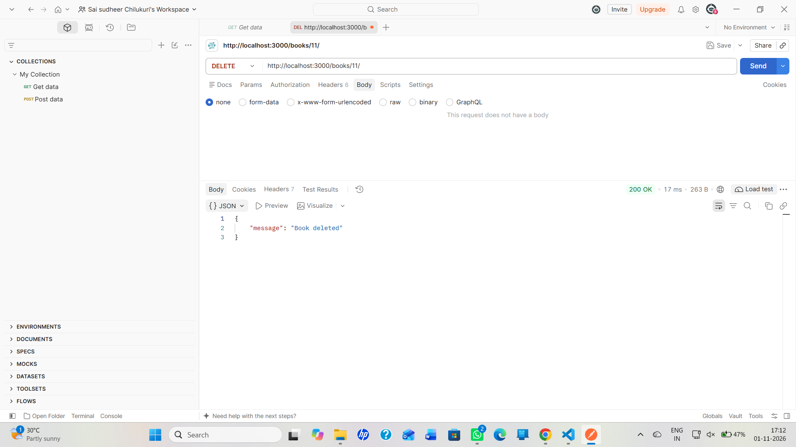
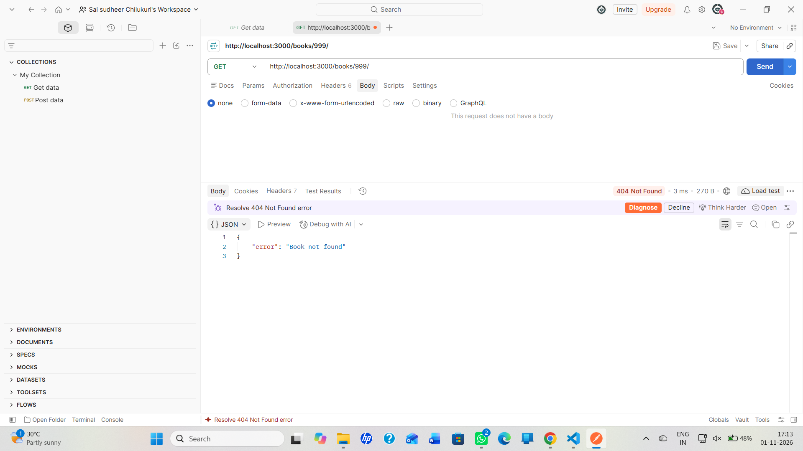

# Lab 2: SQLite database and CRUD routes

Sai Sudheer · 252U1R9127 · 112

**Live link:** (paste after deploy)

## How to run
```bash
cd lab-02
npm install
npm start
```
No environment variables are required. For development with auto-restart use `npm run dev`. The server runs on http://localhost:3000.

## Endpoints
| Method | Path | Description |
|--------|------|-------------|
| GET | /books/ | Get all books |
| GET | /books/:bookId/ | Get one book (404 if missing) |
| POST | /books/ | Add a new book (201) |
| PUT | /books/:bookId/ | Update a book (404 if missing) |
| DELETE | /books/:bookId/ | Delete a book (404 if missing) |

## Screenshots







## Notes
WRITE 2-3 LINES OF YOUR OWN: for example, that the sqlite3 command-line tool was not installed, so I seeded the database with a Node script (seed.js) that runs seed.sql. Also that the free Render plan resets the database file on restart.