# Lab 3: REST API, query parameters, validation, debugging

Sai Sudheer · 252U1R9127 · 112

**Live link:** https://lab-03-8cu9.onrender.com/books/

## How to run
```bash
cd lab-03
npm install
npm start
```
No environment variables are required. For auto-restart during development use `npm run dev`. The server runs on http://localhost:3000.

## Endpoints
| Method | Path | Description |
|--------|------|-------------|
| GET | /books/ | List books. Query params: search_q, order_by, order, limit, offset, min_price, max_price |
| GET | /books/:bookId/ | Get one book (404 if missing) |
| POST | /books/ | Add a book. Validates title, author and numeric price (201 or 400) |
| PUT | /books/:bookId/ | Update a book (200, 400 or 404) |
| DELETE | /books/:bookId/ | Delete a book (200 or 404) |

Defaults for GET /books/: search_q empty, order_by id, order ASC, limit 10, offset 0, min_price 0, max_price 1000000. All errors return `{ "message": "..." }`.

## Postman tests
| # | Request | Expected |
|---|---------|----------|
| 1 | GET /books/ | 200 |
| 2 | GET /books/?search_q=the | 200 |
| 3 | GET /books/?order_by=price&order=DESC&limit=3 | 200 |
| 4 | GET /books/?limit=3&offset=3 | 200 |
| 5 | GET /books/?min_price=300&max_price=400 | 200 |
| 6 | GET /books/?order_by=hack | 400 |
| 7 | GET /books/1/ | 200 |
| 8 | GET /books/999/ | 404 |
| 9 | POST valid body | 201 |
| 10 | POST without title | 400 |
| 11 | POST with price "abc" | 400 |
| 12 | PUT /books/11/ | 200 |
| 13 | DELETE /books/11/ | 200 |

## Screenshots
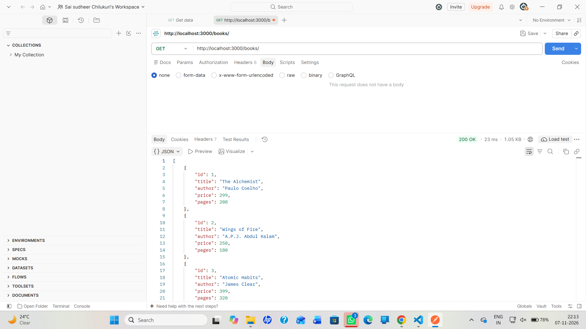
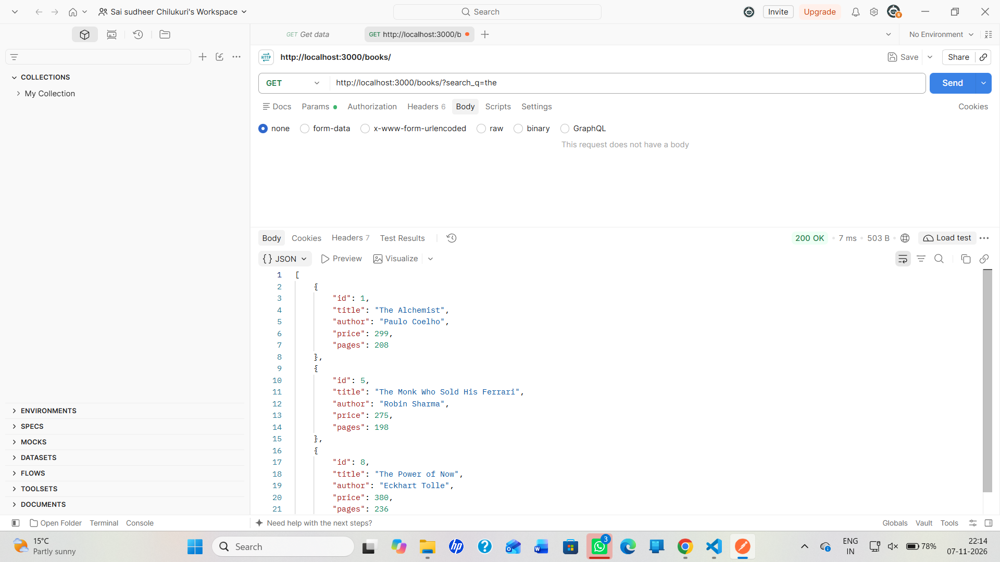
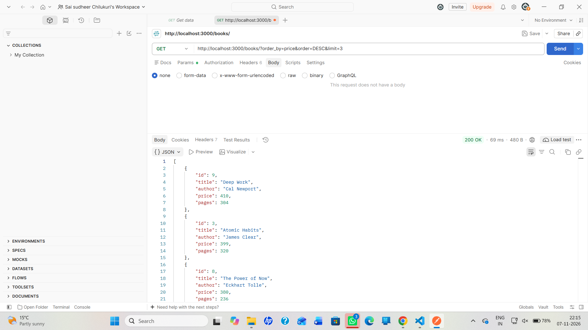
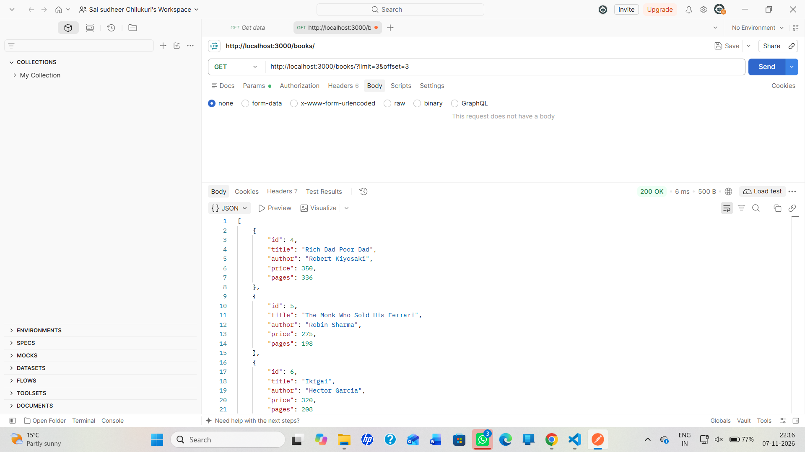
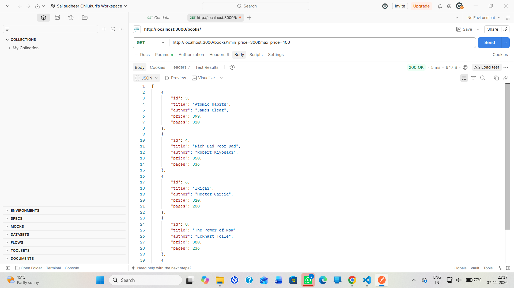
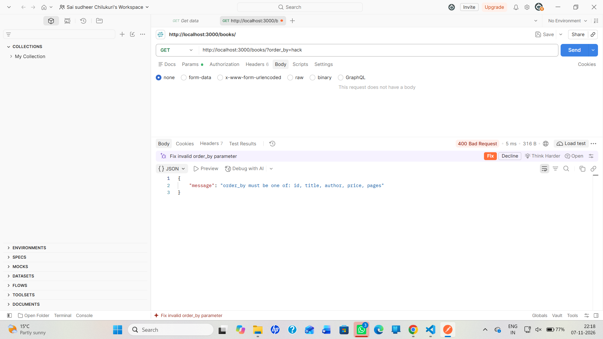
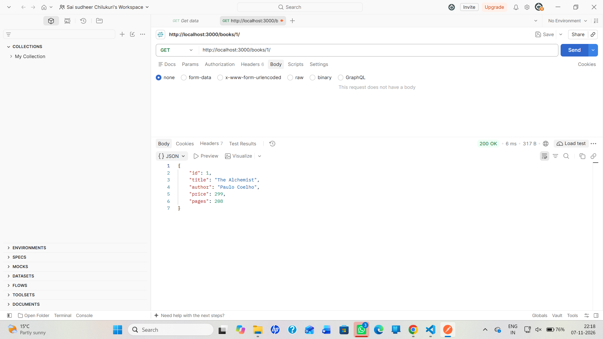
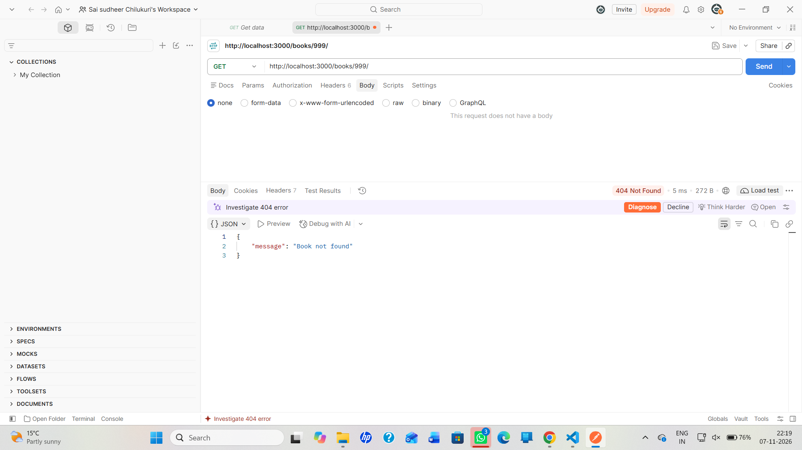
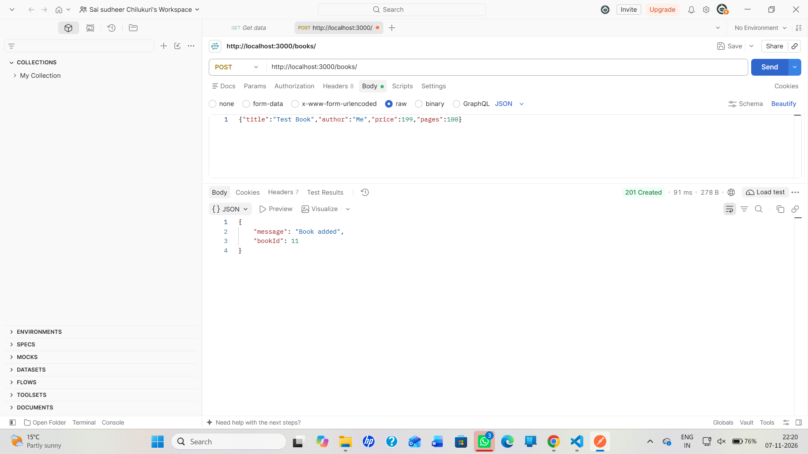

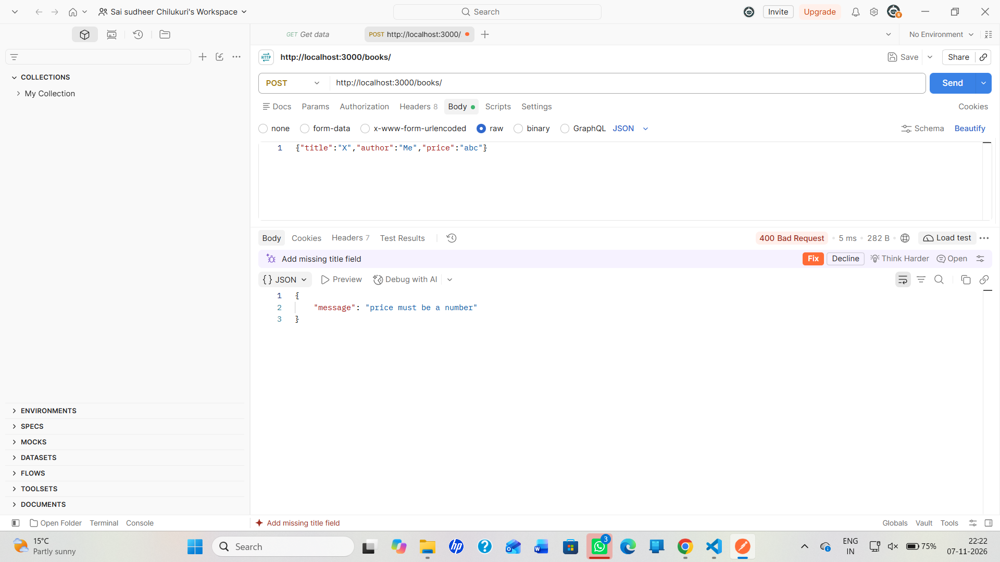
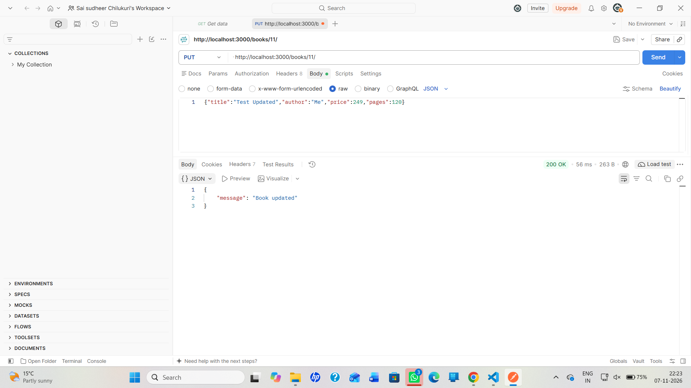
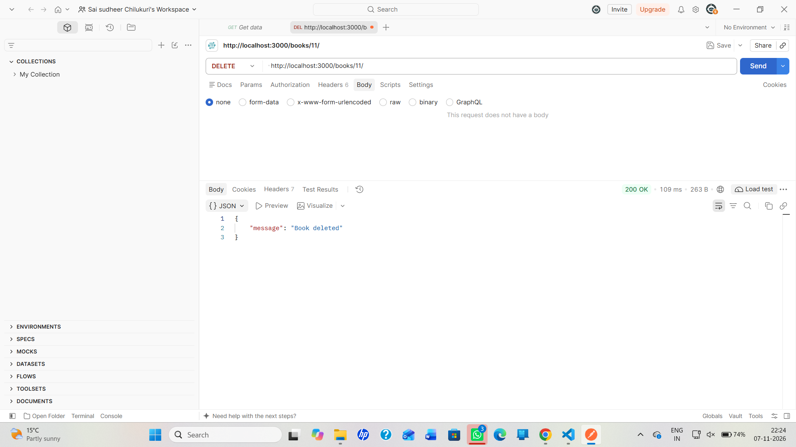

## Notes
- order_by cannot be a `?` placeholder, so it is checked against a whitelist of column names before being used in the SQL. All values use parameterised queries.
- Debugging exercise errors and fixes: EADDRINUSE (port already in use: stop the other process or change the port), wrong import path (fix the require path), "no such table" (the table name must match the one in the database), and a missing await (db calls return Promises, so add await).
- The free Render plan resets the database file on restart, so changes from POST, PUT and DELETE do not persist on the live site.
- Render needed sqlite3 built from source, so the Build Command is `npm install && npm rebuild sqlite3 --build-from-source`.